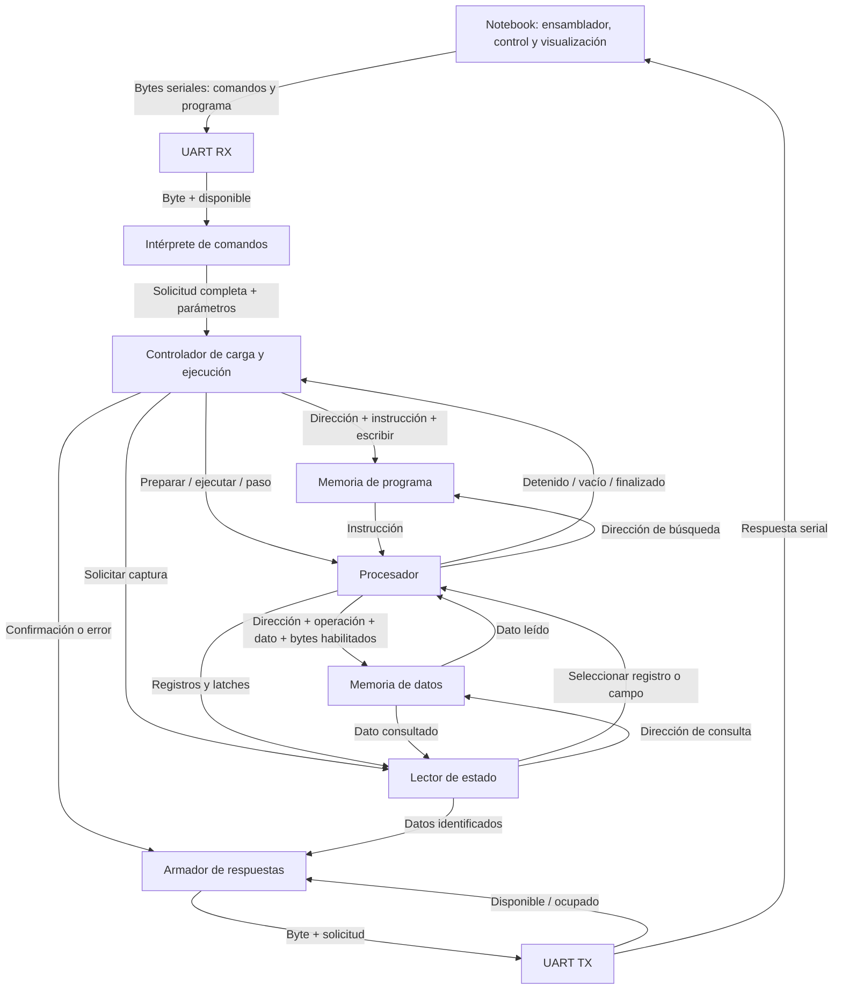
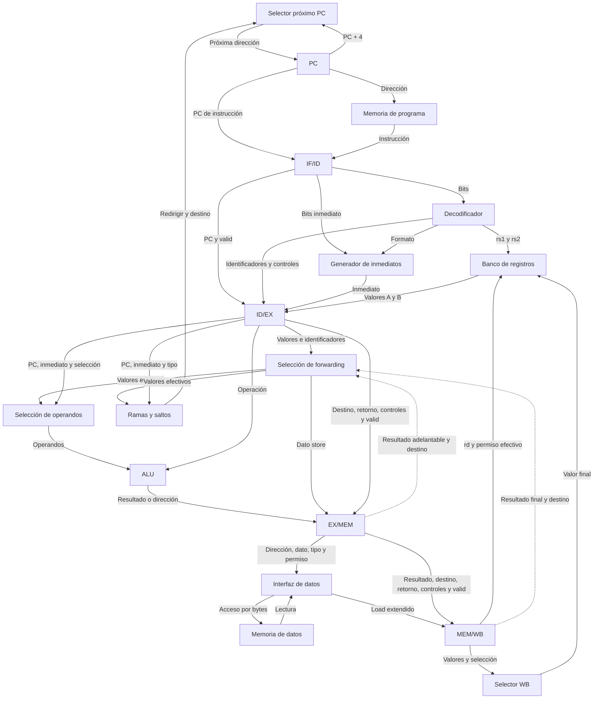
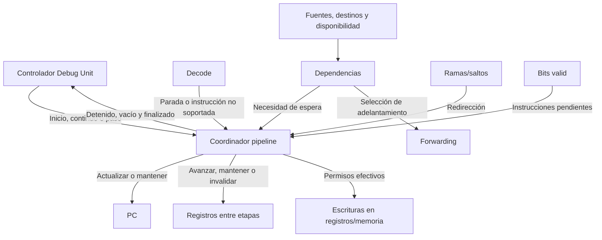
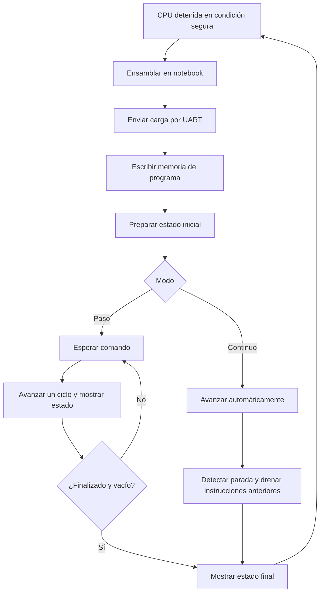

# TP3 — Procesador RISC-V con pipeline y depuración por UART

Este README es el **documento central y vivo del proyecto**. Registra qué queremos construir, qué responsabilidad tiene cada componente y cómo se conectan. Debe evolucionar junto con nuestra comprensión y, posteriormente, con la implementación.

**Estado inicial (21/10/2026): análisis y diseño conceptual.** Este documento no afirma que los módulos estén implementados o verificados. Los nombres de señales son descriptivos, no interfaces HDL definitivas.

## Cómo trabajar con este documento

1. Entender y dibujar antes de escribir HDL: cada componente debe tener una responsabilidad explicable.
2. Revisar el TP2 antes de decidir qué reutilizar; no asumir que sus interfaces sirven sin cambios.
3. Implementar por etapas pequeñas y comprender los datos y controles que circulan.
4. Actualizar aquí las decisiones aceptadas, su motivo y las conexiones que cambien.
5. Registrar comprobaciones realizadas y límites de verificación; no confundir propuesta, simulación y funcionamiento en placa.

Las tablas siguientes son el **reparto propuesto**. Una responsabilidad conceptual no exige un archivo separado; una caja grande puede contener varios módulos. La documentación no autoriza por sí sola cambios de código ni commits.

## 1. Objetivo y requisitos

La consigna del trabajo final pide:

- Procesador RISC-V segmentado en IF, ID, EX, MEM y WB.
- Debug Unit que intercambie información con la notebook por UART.
- Interfaz de usuario CLI, GUI y/o TUI.
- Programa en ensamblador, traducción a lenguaje máquina e instrucción HALT/stop.
- Carga y recarga dinámica de la memoria de programa por UART, sin resintetizar.
- Ejecución continua y paso a paso; un paso corresponde a un ciclo, no a una instrucción completa.
- Visualizar los 32 registros, los latches intermedios y la memoria de datos usada.
- Pipeline vacío al terminar; explicar qué ocurre si falta la parada.
- No intervenir el clock arbitrariamente; analizar temporización y documentar decisiones.

Fuente: `TRABAJO FINAL 2026 (1).pdf`, especialmente páginas 13 a 19. El PDF fue leído durante el análisis; no se incluye una copia en este directorio.

### Instrucciones requeridas

| Grupo | Instrucciones |
|---|---|
| Registro a registro | add, sub, sll, srl, sra, and, or, xor, slt, sltu |
| Inmediatas | addi, andi, ori, xori, slti, sltiu, slli, srli, srai |
| Lecturas | lb, lh, lw, lbu, lhu |
| Escrituras | sb, sh, sw |
| Ramas | beq, bne |
| Saltos | jal, jalr |
| Inmediato superior | lui |
| Parada | HALT/stop: codificación pendiente |

RV32 y palabras de 32 bits son la base propuesta, pendiente de cerrar contra las indicaciones de la cátedra. En `jal`, el destino se obtiene de PC + inmediato y `rd` recibe PC + 4; no confundirlo con la frase de la diapositiva que atribuye el destino a `rd`. En `jalr`, el destino usa rs1 + inmediato, limpiando el bit menos significativo.

## 2. Hardware, programa y datos: tres conceptos distintos

- **Hardware:** Verilog y la configuración generada por Vivado construyen el procesador dentro de la FPGA.
- **Set soportado:** operaciones que ese hardware sabe interpretar. Enviar una operación nueva no crea hardware para ejecutarla.
- **Programa:** secuencia concreta de instrucciones soportadas, con registros, valores y saltos elegidos.
- **Ensamblador:** convierte el texto del programa a codificaciones binarias.
- **Memoria de programa:** guarda las instrucciones enviadas por UART.
- **Registros y memoria de datos:** guardan los valores con los que trabaja ese programa.

Cambiar el programa no requiere reconstruir el procesador. La UART transporta bytes; la Debug Unit escribe las instrucciones en memoria; luego IF las busca usando el PC. No hace falta enviar cada instrucción justo cuando se ejecuta.

Ejemplo ilustrativo:

```asm
addi x1, x0, 5
addi x2, x0, 3
add  x3, x1, x2
HALT
```

Resultado esperado: x3 = 8. x0 siempre vale cero. HALT es simbólico hasta acordar su codificación. Con instrucciones de 32 bits y direccionamiento por bytes, las direcciones consecutivas podrían ser 0, 4, 8 y 12; cada instrucción ocupa cuatro bytes, sin contar el protocolo de carga.

## 3. Jerarquía propuesta

```text
Proyecto
├── Notebook
│   ├── Ensamblador
│   ├── Comunicación y comandos
│   └── Presentación del estado
└── FPGA
    ├── UART: ticks, RX y TX
    ├── Debug Unit
    │   ├── Intérprete de comandos
    │   ├── Controlador de carga y ejecución
    │   ├── Lector de estado
    │   └── Armador de respuestas
    ├── Memoria de programa
    ├── Memoria de datos
    └── Procesador
        ├── PC y selección del próximo PC
        ├── Decodificador y controles
        ├── Banco de registros
        ├── Generador de inmediatos
        ├── Selección de operandos / forwarding
        ├── ALU y lógica de ramas/saltos
        ├── Interfaz de memoria de datos
        ├── Selección de resultado WB
        ├── IF/ID, ID/EX, EX/MEM y MEM/WB
        └── Dependencias, avance, invalidación y finalización
```

## 4. Comunicación, carga y observación



Las flechas a memorias indican responsabilidades, no puertos simultáneos garantizados. Debe existir coordinación de acceso. Propuesta inicial: cargar y observar con la CPU detenida; determinar también cuándo debe estar vacío el pipeline. Las memorias son módulos lógicos independientes, no necesariamente chips externos.

## 5. Contratos: notebook, UART y Debug Unit

### Software de la notebook

| Componente | Recibe | Hace / valida | Entrega | No le corresponde |
|---|---|---|---|---|
| Ensamblador | Texto ensamblador | Sintaxis, registros, operaciones soportadas, inmediatos y etiquetas | Instrucciones binarias o errores | Ejecutar el programa en la FPGA |
| Comunicación y comandos | Programa y acciones del usuario | Armar mensajes, transmitir, comprobar respuestas y tiempos de espera | Confirmaciones, errores y estado recibido | Interpretar señales físicas UART bit por bit |
| Presentación | Estado recibido y acciones del usuario | Mostrar registros, pipeline y memoria según el formato acordado | Información legible y solicitudes del usuario | Inventar estado que no fue recibido |

### UART: solo transporte de bytes

| Componente | Recibe | Hace / valida | Entrega | No le corresponde |
|---|---|---|---|---|
| Generador de ticks | Reloj y reinicio | Generar pulsos con la relación temporal configurada | Ticks para RX/TX | Interpretar comandos |
| RX | Señal serial y referencia temporal | Detectar inicio y reconstruir byte; revisar soporte real de errores de trama en TP2 | Byte, disponible y error si está implementado | Decidir si un comando es válido |
| TX | Byte y solicitud | Serializar y coordinar aceptación mientras está ocupado | Señal serial y disponible/ocupado | Armar respuestas de alto nivel |

RX dice «recibí este byte»; no dice «este comando puede ejecutarse».

### Debug Unit: contenedor de cuatro responsabilidades

| Componente | Recibe | Hace | Valida / controla | Entrega | No le corresponde |
|---|---|---|---|---|---|
| Intérprete de comandos | Bytes de RX | Reconstruir solicitudes | Comando, formato, longitud e integridad si se acuerda | Solicitud completa y parámetros, o error | Calcular instrucciones RISC-V |
| Controlador de carga y ejecución | Solicitudes y estado CPU | Coordinar carga, inicio, continuo, paso y cierre | Acción permitida, rango de carga y exclusión de accesos incompatibles | Escrituras de programa, órdenes CPU, confirmaciones y errores | Decodificar ADD o calcular operandos |
| Lector de estado | Solicitud y acceso a CPU/memoria | Recorrer registros, latches y memoria | Rango y coherencia temporal de la captura | Datos identificados | Alterar resultados observados |
| Armador de respuestas | Datos, confirmaciones y errores | Ordenar respuesta y serializarla en bytes | Esperar disponibilidad TX y no perder bytes | Byte, solicitud TX y fin de respuesta | Decidir el avance del pipeline |

El reparto evita una única máquina de estados que mezcle todo. La división final en archivos se decidirá después. Para capturas coherentes, la propuesta sencilla es mantener la CPU detenida durante la lectura y transmisión.

## 6. Contratos: almacenamiento

| Componente | Recibe | Responsabilidad | Valida / protege | Entrega |
|---|---|---|---|---|
| Memoria de programa | Dirección CPU; dirección, instrucción y permiso de carga | Conservar instrucciones y permitir búsquedas/escrituras coordinadas | Rango y escritura autorizada, mediante su interfaz | Instrucción y disponibilidad según latencia elegida |
| Memoria de datos | Dirección, operación, dato y habilitación por bytes; consulta debug | Conservar datos de loads/stores y permitir observación | Rango, alineación y arbitraje mediante la interfaz acordada | Datos leídos y estado de acceso si se define |

No duplicar validaciones sin motivo: habrá que asignar a un único responsable cada comprobación entre controlador, interfaz y memoria. Una RAM interna normalmente pierde contenido al apagar; la política de recarga debe quedar explícita.

## 7. Contratos: componentes del procesador

**PC significa contador de programa, no notebook.** Los identificadores rs1/rs2/rd son números de registro, no sus valores.

| Componente | Recibe | Responsabilidad | Valida / controla | Entrega |
|---|---|---|---|---|
| PC y selector de próxima dirección | Inicio, avance normal, espera y destino de salto | Conservar y elegir dirección de búsqueda | Avanzar, mantener o redirigir según prioridad acordada | PC actual y siguiente |
| Decodificador y controles | Instrucción | Identificar operación, fuentes, destino y acciones | Combinación de campos soportada | rs1, rs2, rd, controles y detección de instrucción no soportada / parada |
| Banco de registros | rs1/rs2; rd, valor y permiso WB; consulta debug | Conservar x0 a x31 y proporcionar operandos | x0 siempre cero; ignorar su escritura | Valores de lectura y consulta |
| Generador de inmediatos | Bits de instrucción y formato | Reunir y extender inmediato | El formato viene de decode; no valida toda la instrucción | Inmediato preparado |
| Selección de valores actualizados | Valores originales, identificadores y candidatos adelantados | Elegir operandos actuales mediante forwarding si se adopta | Usar solo resultados válidos y disponibles, con prioridad definida | Valores efectivos, incluido dato para store y comparación |
| Selección de operandos ALU | Valores efectivos, PC, inmediato y controles | Elegir entradas del cálculo | Aplicar selección decodificada | Operandos A/B de la ALU |
| ALU | Dos operandos y operación | Aritmética, lógica, desplazamientos y comparaciones requeridas | Semántica con/sin signo; no valida instrucciones completas | Resultado |
| Lógica de ramas y saltos | Valores efectivos, PC, inmediato y tipo | Evaluar condición y obtener destino | Reglas de destino de cada operación | Redirección y destino; retorno disponible para WB |
| Interfaz de memoria de datos | Dirección calculada, tipo/tamaño, dato store y permisos | Preparar escrituras por bytes y adaptar loads | Rango/alineación en el lugar acordado; impedir efectos de instrucciones inválidas | Solicitud a RAM, dato load extendido y error si se define |
| Selección WB | Resultado ALU, load, retorno y control | Elegir valor final | Fuente indicada y permiso efectivo de escritura | Valor para banco de registros |
| Registros entre etapas | Datos, controles, valid y señales de avance | Conservar la información de cada instrucción | Mantener, avanzar o invalidar | Datos y controles estables para próxima etapa |
| Control de dependencias | Fuentes, destinos, validez y disponibilidad | Detectar usos de valores pendientes | Coincidencias relevantes; excluir x0 y destinos sin escritura | Forwarding, espera y solicitud de burbuja |
| Coordinación del pipeline | Permiso debug, dependencias, saltos, parada, errores y valid | Coordinar avance, invalidación y drenaje | Prioridades, instrucciones pendientes y permisos de efectos | Habilitaciones, flush, estado detenido/vacío/finalizado |

«Validar» no implica construir un verificador para cada cálculo. ALU calcula, selector elige y registro conserva; su corrección se comprueba mediante verificaciones apropiadas. Ningún componente debe realizar escrituras por una instrucción inválida ni repetir efectos por estar detenido.

### Registros entre etapas: contenido conceptual

| Registro | Información que debe preservar, según las instrucciones soportadas |
|---|---|
| IF/ID | Instrucción, su PC y valid |
| ID/EX | Valores de operandos, identificadores fuente/destino, inmediato, PC, controles y valid |
| EX/MEM | Resultado/dirección, dato store efectivo, destino, retorno si corresponde, controles y valid |
| MEM/WB | Resultado ALU, dato load, destino, retorno si corresponde, selección WB, permiso y valid |

No son definiciones de bits definitivas. **valid indica presencia de una instrucción con efecto, no legalidad de su codificación.** Una burbuja es una posición inválida.

## 8. Camino de datos del procesador



Las flechas punteadas representan candidatos de forwarding, no disponibilidad universal: un resultado de load puede no estar listo todavía. Se propone resolver ramas/saltos en EX; falta cerrar esta decisión y sus invalidaciones. La latencia real de memorias puede exigir ajustar este esquema y la coordinación con pausa/paso.

## 9. Control y simultaneidad



El reloj común se omite para legibilidad. Propuesta: usar habilitaciones de estado como cpu_ce, no fabricar un clock con lógica combinacional. UART permanece activa aunque la CPU esté pausada. Todos los efectos laterales deben respetar la pausa. Si la memoria tiene respuestas pendientes, habrá que integrarlas explícitamente al mecanismo de paso.

| Ciclo ilustrativo | IF | ID | EX | MEM | WB |
|---|---|---|---|---|---|
| 1 | I1 | — | — | — | — |
| 2 | I2 | I1 | — | — | — |
| 3 | I3 | I2 | I1 | — | — |
| 4 | I4 | I3 | I2 | I1 | — |
| 5 | I5 | I4 | I3 | I2 | I1 |

Es un ejemplo sin riesgos ni latencias adicionales. Un paso habilita un ciclo correcto: una dependencia puede mantener unas etapas mientras otras avanzan. Pausa global y stall local no son equivalentes.

## 10. Flujo de uso, parada y reprogramación



Al reconocer HALT no se debe congelar todo inmediatamente: hay que dejar de buscar, descartar instrucciones posteriores y completar los efectos de las anteriores hasta vaciar el pipeline. Un HALT de un camino descartado no debe terminar el programa. La etapa de reconocimiento y las prioridades aún deben diseñarse.

En paso a paso pueden hacer falta pasos adicionales para drenar. Para ausencia de HALT se propusieron longitud de programa y límite de ciclos, pero no son políticas aceptadas todavía. Llegar al límite de búsqueda requiere considerar instrucciones en vuelo que podrían redirigir el PC.

| Estado al recargar | Política a decidir |
|---|---|
| Programa | Sobrescribir rango, conservar longitud y evitar instrucciones residuales |
| Registros | Elegir inicialización reproducible; x0 siempre cero |
| Datos | Limpiar o exigir inicialización por programa |
| PC y pipeline | Definir entrada, invalidación y neutralización de controles |

## 11. Ejemplo guiado: una suma

Supongamos x1 = 5 y x2 = 3 ya disponibles, e instrucción `add x3, x1, x2`:

1. IF busca la instrucción usando PC y la guarda con su PC en IF/ID.
2. ID reconoce ADD y lee x1/x2. ID/EX guarda 5, 3, destino x3 y controles.
3. EX selecciona operandos y suma: 8. EX/MEM conserva resultado, destino y controles.
4. MEM no accede a memoria de datos para ADD; pasa la información a MEM/WB.
5. WB selecciona 8 y escribe x3 si la instrucción es válida y el avance lo permite.

El resultado viaja junto con «pertenece a x3». Sin ese control no sabríamos dónde guardarlo. Si los valores todavía no estuvieran disponibles, intervendrían forwarding o espera.

## 12. Reutilización del TP2: revisar antes de adaptar

| Base existente | Uso propuesto | Qué falta comprobar |
|---|---|---|
| UART RX/TX y ticks | Transporte de bytes | Interfaces, errores, temporización y funcionamiento actual |
| ALU | Base para operaciones del procesador | Ancho, operaciones, signo y control requerido |
| Interfaz de operandos/operación | Referencia para Debug Unit | Nuevo protocolo, carga y respuestas; no reutilización directa |
| Clock y restricciones de pines | Base de integración | Placa, frecuencias y restricciones efectivas |

El análisis anterior menciona UART 8N1 a 19.200 baudios; no se revalidó aquí contra código ni hardware. No modificar el TP2 entregado como consecuencia de este documento.

## 13. Etapas propuestas de evolución

| Etapa | Objetivo | Evidencia buscada antes de avanzar |
|---|---|---|
| 0. Comprensión y especificación | Componentes, contratos, diagramas y pendientes | Poder explicar una instrucción, un ciclo y cada conexión |
| 1. Revisión TP2 | Identificar reutilización real | Interfaces y comportamiento conocidos |
| 2. Componentes básicos | ALU, registros, decode, inmediatos, memorias | Comportamientos comprobados por componente |
| 3. Pipeline básico | Aritmética y registros entre etapas | Seguimiento de instrucciones y resultados esperados |
| 4. Memoria y dependencias | Loads/stores, forwarding y stalls | Dependencias y accesos con efectos correctos |
| 5. Ramas y saltos | Redirección e invalidación | Caminos tomado/no tomado sin escrituras incorrectas |
| 6. Ejecución y parada | Paso, continuo, inicio y drenaje | Estado final coherente y pipeline vacío |
| 7. UART y depuración | Carga, comandos y capturas | Recarga sin resíntesis y observación coherente |
| 8. Software e integración | Ensamblado, envío y presentación | Programa completo seguido desde notebook |
| 9. Temporización y entrega | Métricas, restricciones y documentación | Evidencia de Vivado y funcionamiento en placa |

Son etapas de aprendizaje, no tareas completadas ni autorización para ejecutarlas automáticamente. Las pruebas concretas y su alcance se acordarán antes de implementar.

## 14. Decisiones pendientes

| Tema | Propuesta o pregunta abierta |
|---|---|
| Arquitectura base | Confirmar RV32, anchos y placa |
| Memorias | Tamaño, tecnología, puertos y latencia; adaptar IF/MEM y pausa |
| Dependencias | Forwarding, load-use, datos store y operandos de ramas; no asumir un stall universal de un ciclo |
| Saltos | Etapa de resolución, destino, invalidación y prioridades |
| Banco de registros | Lectura y escritura del mismo registro en un ciclo |
| HALT | Codificación, reconocimiento y drenaje; evitar efectos de camino descartado |
| Errores | Instrucción no soportada, dirección inválida y accesos desalineados |
| Ausencia de parada | Longitud, fuera de rango, bucles y límite de ciclos |
| Reinicio/recarga | Qué se limpia, cuándo y con qué estado inicial |
| UART | Comandos, longitudes, orden de bytes, integridad y paquetes incompletos |
| Captura | Campos exactos de latches, rango de datos y coherencia temporal |
| Notebook | CLI/GUI/TUI; ensamblador propio o herramienta existente |

## 15. Cómo mantener este corazón del proyecto

- Cuando se acepte una decisión, reemplazar su pendiente por la decisión y el motivo, sin presentarla como implementada.
- Cuando cambie una interfaz, actualizar contrato y flechas en el mismo cambio.
- Mantener separados requisitos de consigna, propuestas, decisiones aceptadas y evidencia observada.
- Agregar rutas reales de módulos y comprobaciones cuando existan; no inventar implementación.
- No convertir el README en un diario de herramientas: conservar lo necesario para comprender y retomar.

**Próximo paso de aprendizaje:** recorrer PC → memoria de programa → IF/ID con una instrucción concreta, aclarar el tiempo de lectura y después agregar ID. No se ha implementado ni verificado HDL como parte de esta documentación.
