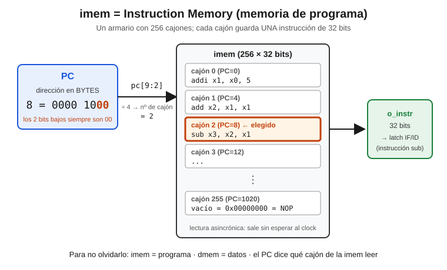

# Etapa IF (Instruction Fetch)

> Archivos fuente: `if_stage.v` (**escrito**) e `imem.v` (*pendiente*; módulos separados, ver D6) · Testbenches: `tb_if_stage.v` (**escrito**), `tb_imem.v` (*pendiente*)
> Ubicación: `tp_final/proyecto_vivado/tp_final_arqui/tp_final_arqui.srcs/{sources_1,sim_1}/new/`
> Estado: **`if_stage` escrito, simulación en Vivado pendiente**; `imem` sin escribir

## 1. Qué hace y por qué existe

IF busca la instrucción que toca ejecutar. Hace tres cosas:

1. **Guarda el PC** (Program Counter): registro de 32 bits con la dirección de la instrucción actual. Es lo único con estado.
2. **Lee la instrucción** de la `imem` en esa dirección.
3. **Calcula la dirección siguiente**: PC+4 normalmente, o el destino de un branch/jump (viene de EX).

### Qué es la `imem`

`imem` = **Instruction Memory**, la memoria de programa. Es un armario con **256 cajones**, cada uno con **una instrucción de 32 bits**. No confundir con `dmem` (memoria de **datos**).



### Por qué el PC se indexa con `pc[9:2]`

- El PC cuenta **bytes** (0, 4, 8, 12...) porque cada instrucción ocupa 4 bytes.
- La `imem` se numera por **cajón** (0, 1, 2, 3...).
- Pasar de PC a cajón es dividir por 4, que en binario es **descartar los 2 bits bajos** (siempre `00`, porque el PC es múltiplo de 4).
- Con 256 cajones alcanzan 8 bits: `pc[9:2]`.

| Instrucción | Cajón | PC |
|---|---|---|
| addi | 0 | 0 |
| add | 1 | 4 |
| sub | 2 | 8 |

### Lectura asincrónica

La instrucción aparece a la salida apenas cambia la dirección, **sin esperar al flanco de clock**. La `imem` se implementa con memoria distribuida (LUTs) y no con Block RAM, que sí exige esperar un ciclo. La **escritura** (carga de programa desde la Debug Unit) sí es sincrónica.

## 2. Interfaz

La etapa IF se reparte en **dos módulos** (decisión D6: cada módulo con una única responsabilidad). `cpu_core` los conecta.

### `if_stage` — maneja el PC

| Puerto | Dir | Ancho | Descripción |
|---|---|---|---|
| `i_clk` | in | 1 | Clock (nunca se corta) |
| `i_reset` | in | 1 | Pone el PC en `0x00000000` (reset sincrónico) |
| `i_enable` | in | 1 | En 0, el PC no cambia (stall o pausa de la Debug Unit) |
| `i_pc_src` | in | 1 | 1 = branch/jump tomado: el próximo PC es `i_pc_target` |
| `i_pc_target` | in | 32 | Dirección destino del salto (la calcula EX) |
| `o_pc` | out | 32 | PC de la instrucción que se busca ahora |

`if_stage` **no recibe la instrucción**: la `imem` la entrega directo al latch `if_id` a través de `cpu_core`.

### `imem` — memoria de programa

| Puerto | Dir | Ancho | Descripción |
|---|---|---|---|
| `i_clk` | in | 1 | Clock (para la escritura sincrónica) |
| `i_we` | in | 1 | Escribir una instrucción |
| `i_waddr` | in | 8 | Número de cajón a escribir (0 a 255) |
| `i_wdata` | in | 32 | Instrucción a guardar |
| `i_raddr` | in | 8 | Número de cajón a leer (`o_pc[9:2]`, lo conecta `cpu_core`) |
| `o_rdata` | out | 32 | Instrucción del cajón `i_raddr` (lectura asincrónica) |

La escritura de la `imem` ignora el `i_enable`: la Debug Unit carga el programa con el procesador frenado.

### Conexión en `cpu_core`

```
if_stage.o_pc ──┬──────────────► if_id (pc)
                └─ [9:2] ──► imem.i_raddr
imem.o_rdata ───────────────────► if_id (instr)
Debug Unit ──► imem.i_we / i_waddr / i_wdata
EX ──► if_stage.i_pc_src / i_pc_target
```

Decisiones de interfaz: un solo `i_enable` (el stall de la `hazard_unit` y la pausa de la Debug Unit se combinan en `cpu_core`); no hay salida PC+4 (EX suma 4 a `o_pc` para `jal`/`jalr`); el `valid` lo genera el latch `if_id`, no IF.

## 3. Comportamiento y decisiones

Ciclo a ciclo para `addi`, `add`, `sub` (sin saltos):

| Ciclo | PC antes del flanco | `imem` entrega | PC después | Entra al latch IF/ID |
|---|---|---|---|---|
| 1 | 0x00 | addi | 0x04 | addi + pc=0x00 |
| 2 | 0x04 | add | 0x08 | add + pc=0x04 |
| 3 | 0x08 | sub | 0x0C | sub + pc=0x08 |

En cada flanco de clock, el PC se actualiza y el latch IF/ID captura la instrucción, a la vez.

- **Stall**: con `enable = 0` el PC no cambia y se vuelve a buscar la misma instrucción. El mismo mecanismo sirve para el `i_enable` global de la Debug Unit (el clock nunca se corta).
- **Salto tomado**: el mux elige el destino en vez de PC+4; las instrucciones que entraron por error se convierten en burbujas (`valid = 0`) con el flush (lo conecta la `hazard_unit`).

Decisiones de IF (a confirmar al definir puertos):
- Valor del PC en reset: `0x00000000`.
- `imem`: 256 × 32 bits, lectura asincrónica, escritura sincrónica desde la Debug Unit.
- Instrucción desconocida = NOP (incluye `0x00000000`, el contenido de la memoria vacía).

## 4. Cómo se prueba

**`tb_if_stage.v`** (autochequeable): genera un clock de 100 MHz, mueve las entradas 1 ns *después* del flanco de subida (para que estén estables en el flanco siguiente) y compara `o_pc` con `!==` (detecta también X). Imprime `ok` por cada chequeo y `TEST OK` o `TEST FALLO: N errores` al final.

| # | Prueba | Esperado |
|---|---|---|
| 1 | Reset | `o_pc = 0x00` |
| 2 | Avance normal | 0x04, 0x08, 0x0C |
| 3 | Stall (`i_enable=0`) por 3 ciclos y reanudar | se queda en 0x0C; al reanudar 0x10 |
| 4 | Salto tomado a 0x40 | 0x40, luego 0x44, 0x48 |
| 5 | `i_enable=0` con `i_pc_src=1` | no salta: queda en 0x48 |
| 6 | Reset a mitad de ejecución | 0x00, luego 0x04 |
| 7 | Reset con `i_pc_src=1` | 0x00 (gana el reset) |
| 8 | Reset con `i_enable=0` | 0x00 (gana el reset) |

**Cómo correrlo en Vivado**: *Simulation Sources → `tb_if_stage` → clic derecho → Set as Top* → *Run Simulation → Run Behavioral Simulation*. Mirar la consola Tcl (debe terminar en `TEST OK`) y la ventana de ondas (`o_pc` en hexadecimal).

**Resultado**: *(pendiente: todavía no se corrió en Vivado; esta PC no tiene simulador)*.

## 5. Errores comunes y problemas que tuvimos

- Indexar la `imem` con `pc` completo en vez de `pc[9:2]`: se lee la palabra equivocada y la dirección se sale de rango.
- Olvidar que el PC avanza de a 4 y no de a 1.

## 6. Preguntas de defensa que cubre

- *¿Qué contiene la memoria de programa y cómo se carga sin resintetizar?* *(parcial: falta la parte de la Debug Unit)*
- *¿Por qué el PC avanza de a 4?* Porque cada instrucción RV32I ocupa 4 bytes y el PC direcciona bytes.
